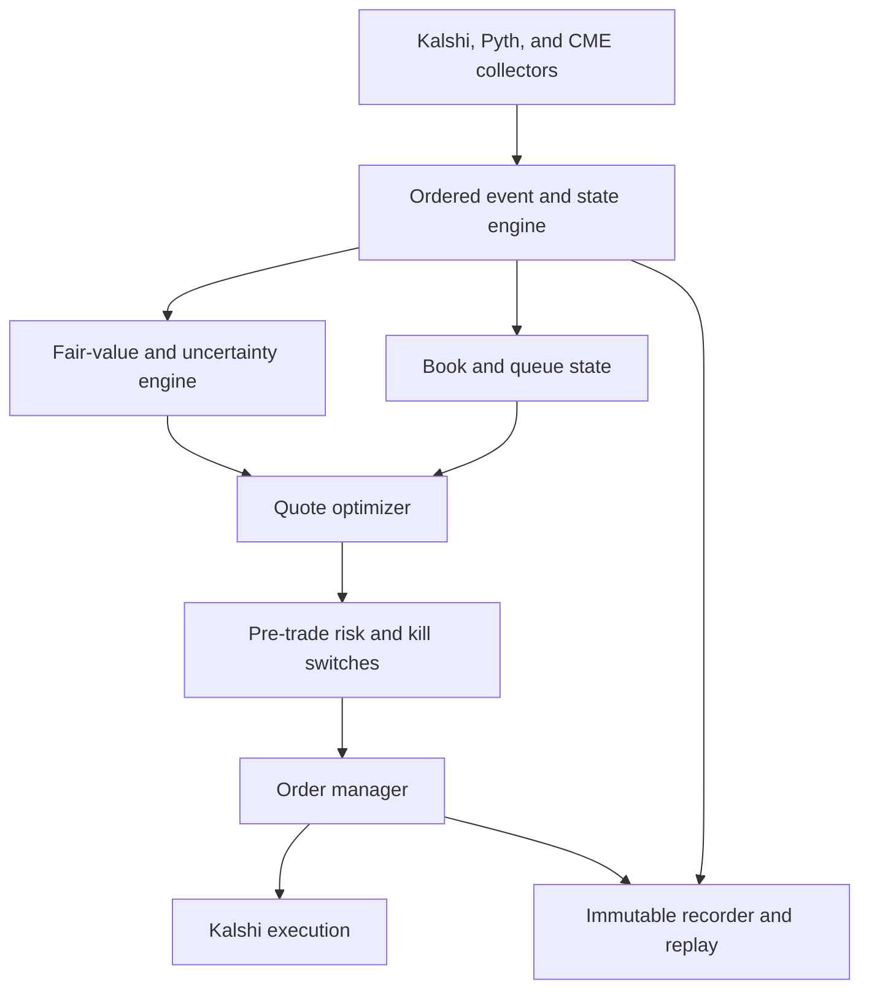

# Kalshi 15-Minute Metals Trading

## Quantitative Research and Implementation Specification

**Version:** 1.0  
**Date:** 2026-08-29  
**Target series:** Gold, silver, and copper 15-minute up/down event contracts  
**Primary venue:** Kalshi  
**External price inputs:** The exact Pyth settlement indices and relevant CME futures  
**Document status:** Ready for quantitative research scoping

---

## 1. Executive decision

The team should investigate and implement this project as a benchmark-replication and market-microstructure strategy. It is not primarily an implied-volatility strategy.

The primary economic hypothesis is:

> After a favorite forms during a 15-minute window, some traders overpay for the probability that the favorite remains the winner. A passive order on the underdog can earn positive expected value if this behavioral premium is larger than fill selection, model error, exit costs, and operational risk.

The secondary hypotheses are:

1. Passive two-sided quoting can capture spread because these series currently charge taker fees but no maker fees.
2. CME futures can lead the exact Pyth settlement index and the Kalshi book. This can improve passive cancels and can sometimes support an aggressive trade after fees.
3. Kalshi liquidity or volume incentives can add P&L when a market is explicitly eligible. Incentives must not be necessary for the base strategy to pass.

The project must keep these three P&L sources separate:

- **S1: Passive favorite fade:** buy the current underdog with resting orders.
- **S2: Neutral spread capture:** quote both outcomes without a target long-underdog position.
- **S3: Feed-lead trading:** use CME innovations to predict the next Pyth and Kalshi state; trade only when expected edge exceeds all direct costs.

No combined strategy can enter production until the team reports the standalone result of S1, S2, and S3.

## 2. Normative language

The terms **MUST**, **SHOULD**, and **MAY** have these meanings:

- **MUST:** required for research validity or production safety.
- **SHOULD:** expected unless there is a documented technical reason.
- **MAY:** optional experiment or implementation choice.

## 3. Scope

### 3.1 In scope

- Exact replication of contract targets and settlements.
- High-frequency recording of the Kalshi order book, trades, and market metadata.
- High-frequency recording of the exact Pyth indices named in each contract.
- High-frequency recording of relevant CME futures books and trades.
- Conditional probability modeling for each contract outcome.
- Passive, queue-aware market-making simulation.
- Fill-conditioned favorite calibration and adverse-selection analysis.
- Event-driven backtesting with inventory feedback.
- A shadow live system and a small controlled pilot.
- Optional Kalshi-only exits.
- Optional futures hedging as a separate research experiment, not as part of the base result.

### 3.2 Out of scope for the first production decision

- A general stochastic-volatility research program.
- Deep neural networks.
- Direct COMEX connectivity unless the measured lead supports its cost.
- A strategy whose expected P&L depends on an unconfirmed incentive payment.
- A backtest that assumes fills from trades at the quoted price without queue treatment.
- Unspecified discretionary exits.
- External hedging in the base strategy.
- Trading scheduled macroeconomic events before a separate event model passes.

## 4. Required contract audit

The live system MUST read current contract metadata. It MUST NOT hard-code the following facts across products.

For each market, record and validate:

- Series ticker.
- Event ticker.
- Market ticker.
- Contract title.
- Exact settlement source name and URL.
- Pyth symbol and feed identifier, when supplied.
- Open time.
- Close time.
- Expected determination time.
- Target price.
- Rounding digits.
- Greater-than versus greater-than-or-equal rule.
- Stale-source fallback rule.
- Price-level structure and valid tick ranges.
- Fractional-contract support.
- Current fee multiplier and maker/taker treatment.
- Current incentive eligibility and incentive schedule.
- Position limits.
- Exchange shard or execution lane.

### 4.1 Current known behavior, subject to daily validation

As of the document date:

- Gold, silver, and copper 15-minute series are in the standard fee group. Makers pay no exchange trading fee. Takers pay the standard quadratic fee.
- Gold target and settlement values use two decimal places in observed contracts.
- Silver target and settlement values use three decimal places in observed contracts.
- Rounding is product-specific.
- A tie resolves Yes because the condition is greater than or equal to the target.
- If the specified source value is unavailable, Kalshi can use the most recently available published value.
- The observed gold contract identifies `Metal.Index.GOLD/USD`. The team MUST use the exact contract feed and MUST NOT substitute generic `XAU/USD` without a proven mapping.

These facts are inputs to a startup audit. They are not permanent code constants.

### 4.2 Settlement checksum

Before model research, the team MUST reconcile at least 1,000 completed windows across the target products, or all available windows if fewer exist.

For each window:

1. Reconstruct the opening target from the exact one-minute source candle that ends at the window open.
2. Apply the contract-specific rounding rule.
3. Reconstruct the final settlement value from the exact one-minute source candle that ends at the window close.
4. Apply the stale-source fallback rule when applicable.
5. Predict Yes or No.
6. Compare the prediction with the exchange result.

The production gate is 100% agreement on all usable windows. Any mismatch blocks live trading until it is classified as one of:

- Missing source data.
- Timestamp error.
- Wrong feed symbol.
- Wrong candle boundary.
- Wrong rounding rule.
- Source revision.
- Exchange correction.
- Unresolved discrepancy.

An unresolved discrepancy is a hard stop.

### 4.3 Market lifecycle

The system MUST treat the target as unknown before it is published.

For every window:

1. Discover the upcoming event and market.
2. Subscribe to market data before the open when possible.
3. At the open, re-read market metadata.
4. Wait until the target is present and is not a placeholder such as `TBD`.
5. Reconstruct the target independently from the exact source candle.
6. Enable model calculation only after the exchange target and independent target agree.
7. Enable orders only after the Kalshi book, Pyth feed, CME feed, clock, fee registry, and risk state are valid.
8. Cancel all resting orders before the exchange close with a configurable safety margin.
9. Block new orders at or after the local close cutoff.
10. Continue recording until determination and settlement reconciliation are complete.

If the target changes after the strategy is enabled, cancel all orders and block the market pending investigation.

## 5. Notation and payoff representation

Let:

- \(K\): fixed target price for the current window.
- \(T\): contract close time.
- \(t\): current time.
- \(\tau=T-t\): time remaining.
- \(B_t\): latest exact Pyth settlement-index value.
- \(\widehat B_t\): best current estimate of the settlement index after applying external futures information.
- \(F_t\): relevant CME futures price.
- \(g\): settlement rounding grid.
- \(Y=1\): the rounded final index is at least \(K\).
- \(p_t=\Pr(Y=1\mid\mathcal I_t)\): fair Yes probability.
- \(m_t\): Kalshi Yes midpoint.
- \(q_Y\): number of Yes contracts held.
- \(q_N\): number of No contracts held.
- \(d=q_Y-q_N\): net Yes outcome exposure.

The exact fair value is:

\[
p_t=Pr\left(\operatorname{round}_g(B_T)\ge K\mid\mathcal I_t\right).
\]

The terminal payoff of the position is:

\[
q_N+dY.
\]

The terminal variance caused by the directional exposure is:

\[
\operatorname{Var}(\text{payoff})=d^2p_t(1-p_t).
\]

This payoff representation MUST be the base inventory-risk representation. Aggregate vega is not a sufficient risk limit.

### 5.1 Yes/No book conversion

Kalshi books contain Yes bids and No bids.

- A Yes bid at \(b_Y\) has hold-to-settlement edge \(p_t-b_Y\).
- A No bid at \(b_N\) has hold-to-settlement edge \((1-p_t)-b_N\).
- A Yes ask at \(a_Y\) is equivalent to a No bid at \(1-a_Y\).
- A No ask at \(a_N\) is equivalent to a Yes bid at \(1-a_N\).

All strategy and simulator code MUST use one outcome-side abstraction. It MUST not contain separate informal logic for “selling Yes” and “buying No.”

## 6. Strategy definitions

### 6.1 Strategy S1: passive favorite fade

S1 is the primary hypothesis.

Define the current market favorite from a reliable two-sided Kalshi midpoint or microprice:

- Yes is the favorite if \(m_t>0.5\).
- No is the favorite if \(m_t<0.5\).

Do not infer the current favorite from a stale last trade. If the book is one-sided and no reliable market probability exists, S1 does not quote.

The desired S1 trade is to buy the underdog with a resting order:

- If Yes is the favorite, place a No bid.
- If No is the favorite, place a Yes bid.

For a filled No bid at price \(b_N\), expected edge is:

\[
e_N=(1-p_t)-b_N.
\]

For a filled Yes bid at price \(b_Y\), expected edge is:

\[
e_Y=p_t-b_Y.
\]

The research hypothesis is fill-conditional. For example, an 85-cent Yes offer has true maker edge only if:

\[
0.85>\Pr(Y=1\mid\text{the resting offer was lifted},X_t).
\]

The conditioning on the fill MUST be present in all analysis.

#### 6.1.1 Preferred state region

The initial state partition is:

| Region | \(|z|\) | Approximate Yes price | Primary purpose |
| --- | ---: | ---: | --- |
| Center | 0.0–0.5 | 31–69 cents | Spread capture; small S1 size |
| S1 core | 0.5–1.5 | 7–31 or 69–93 cents | Favorite-fade research and trading |
| Extreme | Above 1.5 | Below 7 or above 93 cents | Small or no quotes until tail calibration passes |

where the diagnostic Gaussian moneyness is:

\[
z=\frac{\log(\widehat B_t/K)}{\widehat\sigma_t\sqrt\tau}.
\]

The price band, not the Gaussian model, determines execution eligibility. The \(z\) variable is a standardized research feature.

#### 6.1.2 Time buckets

Research and policy tables MUST use at least these remaining-time buckets:

- 10–15 minutes.
- 5–10 minutes.
- 2–5 minutes.
- 1–2 minutes.
- 30–60 seconds.
- Less than 30 seconds.

Initial production policy MUST stop new S1 orders with less than 120 seconds remaining. The team MAY reduce this boundary only after the latency and markout study supports the change.

### 6.2 Strategy S2: neutral spread capture

S2 quotes both outcomes when both bids have positive risk-adjusted edge.

S2 targets \(d=0\). It is not allowed to inherit the desired underdog inventory of S1 in its standalone backtest.

For each possible Yes and No bid, calculate:

\[
e_Y^{risk}=p_t-b_Y-\lambda\left[(d+1)^2-d^2\right]p_t(1-p_t),
\]

\[
e_N^{risk}=(1-p_t)-b_N-\lambda\left[(d-1)^2-d^2\right]p_t(1-p_t).
\]

Here, \(\lambda\) is a documented dollar risk penalty. For the multi-market portfolio, replace the scalar variance with the change in portfolio variance under the current covariance matrix.

S2 places an order only if the risk-adjusted edge exceeds the configured minimum after model uncertainty and expected adverse selection.

### 6.3 Strategy S3: feed-lead trading

S3 uses CME futures to predict the current or next exact Pyth index state.

At the latest Pyth update time \(u\), define:

\[
\widehat B_t=B_u+\beta_{j,t}(F_t-F_u)+c_t,
\]

where:

- \(j\) identifies the futures contract and roll regime.
- \(\beta_{j,t}\) is estimated from prior data only.
- \(c_t\) is a slow basis correction.

The system must compare a Kalshi price with the distribution of the future settlement value, not only with \(\widehat B_t\).

An aggressive Yes purchase at price \(a_Y\) is eligible only if:

\[
p_t-a_Y-f_{taker}(a_Y)-s_{exec}-u_{model}>e_{min},
\]

where:

- \(f_{taker}\) is the current taker fee.
- \(s_{exec}\) is expected slippage and latency loss.
- \(u_{model}\) is a conservative model-uncertainty charge.
- \(e_{min}\) is an additional required edge.

The symmetric rule applies to No.

S3 MUST use marketable limit orders with a strict price cap. It MUST use a unique idempotent client order identifier. If immediate-or-cancel behavior is not supported by the selected API path, the system MUST send an immediate cancel after the order acknowledgment and include the cancel-flight fill risk in simulation.

### 6.4 Incentive overlay

Incentives are an overlay, not a strategy.

The system MUST distinguish:

- Volume reward pools.
- Public snapshot-based liquidity reward pools.
- Designated-liquidity-provider agreements.

The base backtest uses zero incentive revenue. Separate reports MAY show:

1. Zero incentive.
2. Actual realized incentive.
3. Conservative expected incentive.
4. Maximum legal or program cap.

Only cases 1 and 2 can be included in audited historical P&L. A strategy fails if it is negative in case 1 unless the explicit business decision is to operate an incentive-only program.

## 7. Required data

All raw data MUST be immutable. All normalized data MUST be reproducible from raw data and versioned code.

Every timestamped record MUST contain:

- Source event timestamp, if supplied.
- Source publish timestamp, if supplied.
- Local receive timestamp from a monotonic clock.
- UTC wall-clock receive timestamp.
- Ingestion sequence number.
- Source sequence number, if supplied.

Use UTC nanoseconds in normalized tables. Preserve the original timestamp fields.

### 7.1 Kalshi market metadata

Create `market_dim` with one row per market version.

Required fields:

| Field | Type | Notes |
| --- | --- | --- |
| `market_ticker` | string | Primary key with metadata version |
| `event_ticker` | string | Event identifier |
| `series_ticker` | string | Product series |
| `metal` | enum | Gold, silver, copper |
| `open_ts_ns` | int64 | UTC |
| `close_ts_ns` | int64 | UTC |
| `determination_ts_ns` | int64 | UTC |
| `target_price` | decimal | Preserve full precision |
| `round_digits` | int | Contract rule |
| `strike_type` | string | Must record greater-or-equal |
| `settlement_source_name` | string | Exact source |
| `settlement_source_url` | string | Exact URL |
| `pyth_symbol` | string | Nullable only if absent |
| `pyth_feed_id` | string | Nullable only if absent |
| `price_level_structure` | string | Do not infer tick size from series |
| `price_ranges_json` | JSON | Valid tick bands |
| `fractional_enabled` | bool | Quantity logic input |
| `exchange_index` | int | Execution lane |
| `metadata_version` | int | Monotonic local version |
| `metadata_hash` | string | Hash of normalized rule-relevant fields |
| `metadata_receive_ts_ns` | int64 | Version time |

Store the full source response next to the normalized row.

### 7.2 Kalshi order-book events

Create `kalshi_book_event` from the initial snapshot and ordered deltas.

Required fields:

- Market ticker.
- WebSocket connection identifier.
- Subscription identifier.
- Source sequence number.
- Message type: snapshot, add, reduce, remove, reset.
- Outcome side: Yes or No.
- Price in fixed-point dollars.
- Quantity in fixed-point contracts.
- Source timestamp.
- Receive timestamp.
- Gap flag.
- Recovery snapshot identifier.

Rules:

- A sequence gap invalidates the local book immediately.
- No strategy decision is allowed on an invalid book.
- The system must request or obtain a new snapshot before resuming.
- Integer-cent fields must not be used when the market supports sub-cent prices.
- Quantity must retain fractional precision.

### 7.3 Kalshi trades

Create `kalshi_trade` with:

- Trade identifier.
- Market ticker.
- Yes price.
- No price.
- Quantity.
- Aggressor or taker side.
- Block-trade flag.
- Source timestamp.
- Receive timestamp.
- Corresponding local book sequence, when available.

Block trades MUST be excluded from central-limit-order-book fill modeling unless they changed the visible book through normal matching.

### 7.4 Own order lifecycle

Create `order_lifecycle` in shadow and live operation.

Required events:

- Decision created.
- Submit sent.
- Submit acknowledged.
- Order resting.
- Partial fill.
- Full fill.
- Cancel decision.
- Cancel sent.
- Cancel acknowledged.
- Cancel rejected.
- Post-only rejection.
- Timeout.
- Reconciliation correction.

Required identifiers and values:

- Logical quote identifier.
- Unique client order identifier.
- Exchange order identifier.
- Strategy module.
- Model version.
- Config version.
- Outcome side.
- Price.
- Original quantity.
- Remaining quantity.
- All timestamps.
- Fee charged.
- Exchange index.
- State snapshot hash used for the decision.

### 7.5 Pyth raw updates

Create `pyth_tick` for the exact contract feed.

Required fields:

- Pyth symbol.
- Feed identifier.
- Price.
- Confidence interval.
- Exponent.
- Publish timestamp.
- Receive timestamp.
- Feed status.
- Publisher count or quality metadata, if available.
- Source endpoint or distributor.
- Raw message identifier.

The team MUST also store or reconstruct exact one-minute candles used for target and settlement. The one-minute candle logic MUST be tested at UTC and daylight-saving boundaries.

As of the document date, Pyth states that Hermes access requires an API key. Data licensing and use rights MUST be confirmed before production.

### 7.6 CME futures data

Record top-of-book and trades for the primary and adjacent contracts:

- Gold: GC and MGC where useful.
- Silver: SI and SIL where useful.
- Copper: HG and the applicable smaller contract where useful.

Required fields:

- Instrument identifier and contract month.
- Exchange timestamp.
- Receive timestamp.
- Bid price and size.
- Ask price and size.
- Trade price and size.
- Aggressor inference, if not supplied.
- Trading status.
- Session state.
- Sequence number.

Instrument definitions, tick values, trading schedules, and roll dates MUST be stored. The active futures mapping MUST be versioned by date and time. The team MUST test front-month, most-liquid-contract, and continuous weighted mappings. It MUST not assume a constant spot-futures basis.

### 7.7 Event calendar

Create `calendar_event` with scheduled timestamps for:

- CPI.
- PPI.
- Employment report and nonfarm payrolls.
- Initial jobless claims.
- Retail sales.
- GDP.
- PCE inflation.
- FOMC statements, press conferences, and minutes.
- Treasury refunding and large auctions where relevant.
- Major central-bank decisions.
- Known metals-specific reports.
- CME maintenance and session breaks.
- Pyth maintenance.
- Kalshi maintenance.

Store the scheduled timestamp as known before the event. Revised timestamps must create new versions. Actual surprise data MAY be added after release for analysis but cannot enter a pre-release feature.

### 7.8 Options and volatility reference data

The following data is useful but not required for the first baseline:

- Front listed GC, SI, and HG option ATM volatility.
- Risk reversals and butterflies.
- Time to listed expiry.
- Intraday futures realized volatility.

Listed option volatility is a regime feature. It is not a direct hedge price for a 15-minute digital.

### 7.9 Infrastructure telemetry

Record:

- Clock offset and clock-sync status.
- WebSocket reconnects.
- Sequence gaps.
- API response codes.
- Rate-limit token estimates.
- `429` responses.
- Submit, acknowledgment, cancel, and cancel-ack round trips.
- Feed interarrival times.
- Garbage-collection or runtime pauses.
- CPU saturation.
- Network errors.

### 7.10 Fee and incentive registries

Create `fee_schedule_dim` with:

- Effective start and end timestamps.
- Series ticker or standard fee-group identifier.
- Maker-fee enabled flag.
- Taker coefficient.
- Maker coefficient or multiplier.
- Product fee multiplier.
- Account-type precision rule.
- Source document and retrieval timestamp.
- Manual approval identifier.
- Configuration hash.

Create `incentive_program_dim` with:

- Program identifier and program type.
- Eligible market or series.
- Eligible participant class.
- Start and end timestamps.
- Maker-only, taker-only, or all-volume treatment.
- Eligible price range.
- Reward-pool amount.
- Per-contract cap.
- Target size.
- Discount factor.
- Snapshot rules.
- Maximum spread, minimum size, uptime, and coverage duties where applicable.
- Source document and retrieval timestamp.
- Configuration hash.

Live trading MUST use an approved version of each registry. An unrecognized program or fee change invokes a kill switch.

### 7.11 Settlement records

Create `kalshi_settlement` with:

- Market ticker.
- Exchange result.
- Exchange settlement value.
- Exchange determination timestamp.
- Independently reconstructed opening target.
- Independently reconstructed final value.
- Exact Pyth source update identifiers used for each value.
- Applied rounding digits.
- Tie flag.
- Stale-source fallback flag and source age.
- Predicted result.
- Agreement flag.
- Discrepancy classification.
- Audit code version.

## 8. Storage and data quality

### 8.1 Suggested layout

```text
data/
  raw/
    kalshi/
    pyth/
    cme/
    calendar/
  normalized/
    market_dim/
    kalshi_book_event/
    kalshi_trade/
    pyth_tick/
    cme_quote/
    cme_trade/
    calendar_event/
    order_lifecycle/
  derived/
    book_state/
    settlement_check/
    model_features/
    simulated_orders/
    pnl/
```

Use date and metal partitions. Parquet with Zstandard compression is suitable for normalized and derived data. Raw source messages should remain in their native representation or a lossless framed format.

### 8.2 Daily quality report

The daily report MUST include:

- Expected and observed windows.
- Missing markets.
- Settlement checksum status.
- Kalshi sequence gaps and invalid-book time.
- Pyth missing time and stale intervals.
- CME missing time and crossed or invalid books.
- Clock offset percentiles.
- Timestamp ordering violations.
- Duplicate message counts.
- Unknown aggressor-side rate.
- Fractional-quantity parsing failures.
- Metadata changes.
- Fee or incentive changes.

Windows with unresolved gaps are excluded from model fitting and main backtests. Exclusion reasons must be reported.

## 9. Research program

The research work must follow this order.

### 9.1 R0: settlement and source replication

Outputs:

- Exact target reconstruction rate.
- Exact settlement reconstruction rate.
- Tie frequency by metal, time of day, and volatility regime.
- Source-staleness frequency and duration.
- Contract metadata change log.
- Exact mapping from Pyth symbol to CME instrument and roll regime.

No other result is trusted until R0 passes.

### 9.2 R1: market capacity and microstructure

For each metal, price bucket, and time bucket, estimate:

- Total contracts traded.
- Aggressive volume.
- Maker-addressable volume.
- Median and distribution of spread.
- Depth at the first five levels.
- Frequency of one-sided books.
- Frequency of empty price levels.
- Queue size ahead of a new order.
- Order-level residence time where inferable.
- Trade-through frequency.
- Fill intensity at 0, 1, 2, and 3 ticks from midpoint.
- Maker-to-maker exit availability.
- Maker-to-taker exit frequency and cost.

Capacity reports MUST use contract count and risk dollars. Headline venue dollar volume is not sufficient.

Evaluate order sizes of 1, 10, 50, 100, 250, and 500 contracts. A size cannot assume more than 10% of observed displayed depth without a separate market-impact charge.

### 9.3 R2: favorite-flow analysis

Transform each state into favorite/underdog coordinates.

For each trade, record:

- Current favorite side.
- Favorite price.
- Whether the taker bought the favorite.
- Standardized moneyness \(z\).
- Time remaining.
- Recent return over 1, 5, 15, and 60 seconds.
- Pyth confidence.
- CME-Pyth basis residual.
- Calendar-event state.
- Subsequent markouts.
- Final winner.

Required tables:

1. Aggressive favorite-buy volume by price and time remaining.
2. Aggressive underdog-buy volume by price and time remaining.
3. Favorite settlement frequency after first reaching each price.
4. Favorite settlement frequency after an aggressive favorite purchase.
5. Favorite settlement frequency after a hypothetical resting underdog order would fill.
6. Results split by recent momentum direction.
7. Results split by scheduled-event and normal windows.
8. Results split by metal and session.

The primary test is:

\[
H_0:\Pr(\text{favorite wins}\mid\text{maker underdog fill},X)=P_{fill}.
\]

The alternative needed by S1 is that the favorite wins less often than the fill price implies.

### 9.4 R3: markout and adverse-selection surfaces

Estimate maker markout after a hypothetical fill at:

- 100 milliseconds.
- 500 milliseconds.
- 1 second.
- 5 seconds.
- 30 seconds.
- 2 minutes.
- Settlement.

Bucket by:

- Metal.
- Outcome side.
- Favorite or underdog.
- Price.
- Time remaining.
- Quote distance.
- Recent momentum.
- Event state.
- Pyth confidence state.
- Basis-residual state.

Define short-horizon adverse selection for a buy as the fall in model-free executable liquidation value after the fill. Report both midpoint and executable markouts.

### 9.5 R4: futures-to-Pyth lead study

Simple cross-correlation is not an acceptable final test.

The study MUST:

1. Use event-time CME innovations.
2. Compare source timestamps and receive timestamps separately.
3. Estimate the Pyth response at 10, 25, 50, 100, 250, 500, and 1,000 milliseconds.
4. Estimate the Kalshi midpoint and executable-price response on the same horizon.
5. Split by session, event state, and Pyth-confidence state.
6. Use rolling or expanding out-of-sample estimation.
7. Include a stale-futures placebo.
8. Include Pyth inputs lagged by 100, 250, and 500 milliseconds.
9. Include a deliberately wrong basis mapping.
10. Report the executable edge after current taker fees.

The key output is the distribution of:

\[
\Delta p_{fair}-\Delta p_{Kalshi}
\]

available after the team’s measured data and order latency.

The lead half-life must be compared with full submit-to-match and cancel-to-match latency. A statistical lead that decays before execution has zero trading value.

### 9.6 R5: capitulation hypothesis

Define a candidate capitulation event:

1. The favorite reaches at least 80 cents.
2. The favorite retraces through 70 and then 65 cents.
3. Aggressive flow changes from favorite buying to favorite selling.

Measure:

- Flow imbalance during and after the retrace.
- Probability of further retrace.
- Probability of final favorite win.
- Fill availability at 70, 65, 60, and 55 cents.
- Markout and settlement P&L from buying the new underdog.

This is a separate optional module. The base strategy must reserve no capacity for capitulation until R5 passes out of sample.

## 10. Fair-value model

### 10.1 Baseline Gaussian model

Use the Gaussian digital only as the first benchmark:

\[
p_t^{G}=\Phi\left(
\frac{\log(\widehat B_t/K)+(\widehat\mu_t-\tfrac12\widehat\sigma_t^2)\tau}
{\widehat\sigma_t\sqrt\tau}
\right).
\]

The production probability must apply the exact settlement rounding in a discrete calculation or simulation.

At 15 minutes, the drift and Itô terms are usually small in normal windows. They remain in the implementation because recent momentum and scheduled events can make a zero-drift assumption wrong.

### 10.2 Settlement-index estimator

The exact Pyth value is the anchor. Futures are a leading feature.

Recommended estimator:

1. Take the latest valid Pyth value \(B_u\).
2. Measure futures movement from the corresponding futures value \(F_u\).
3. Apply a robust, rolling log-return beta.
4. Add a slow basis-state estimate.
5. Propagate the residual variance as measurement uncertainty.

Estimate beta separately by:

- Metal.
- Futures contract.
- Roll regime.
- Trading session.
- Normal versus event window.

Use a robust regression or a Kalman filter. Fit only on data available before the decision day.

The model output is a distribution for the current latent settlement index, not only a point estimate.

### 10.3 Remaining-horizon variance

Forecast integrated variance from \(t\) to \(T\), not a generic annualized volatility.

The first model SHOULD combine:

- Quarter-hour time-of-day seasonal variance.
- Fast EWMA variance from 1-second or 5-second returns.
- One-hour realized variance.
- One-day realized variance.
- Scheduled-event multiplier.
- Pyth-confidence state.
- CME spread and depth state.

A suitable initial form is:

\[
\log \widehat V_{t,T}
=a_{metal,bucket}
+b_1\log RV_{5m}
+b_2\log RV_{1h}
+b_3\log RV_{1d}
+b_4 I_{event}
+b_5\log(1+conf_t/B_t).
\]

Fit with regularization and expanding-window validation. Use robust realized-variance estimators to reduce feed microstructure noise.

### 10.4 Conditional return distribution

The team must compare at least:

1. Gaussian residuals.
2. Student-t residuals.
3. Empirical standardized residual CDF.
4. A regularized direct probability model.

The empirical CDF should use partial pooling across:

- Metal.
- Time of day.
- Remaining horizon.
- Event state.
- Recent momentum state.

Sparse buckets must shrink toward a global metal distribution. No bucket can use fewer than a documented effective sample count without shrinkage.

The direct probability model MAY use:

- Standardized distance to target.
- Time remaining.
- Recent returns.
- Futures-Pyth innovation.
- Pyth confidence.
- CME spread and depth.
- Kalshi order imbalance.
- Aggressive Kalshi flow.
- Session and event indicators.

Use logistic or probit regression with strong regularization before any nonlinear model.

### 10.5 Independent fair and execution fair

Maintain two probability estimates.

#### External fair

`p_external` uses only information outside the Kalshi book:

- Exact Pyth feed.
- CME futures.
- Time remaining.
- Time-of-day variance.
- Event calendar.
- External volatility references.

Use `p_external` to measure whether Kalshi prices and fills contain a favorite premium. It MUST not use Kalshi midpoint, Kalshi order imbalance, or Kalshi trade flow.

#### Execution fair

`p_execution` MAY add Kalshi book and flow features. Use it for short-horizon cancel and execution decisions after the external premium has been measured.

Report S1 performance with both estimates. If S1 exists only when Kalshi price or flow enters the fair model, classify it as a microstructure-prediction strategy, not as independent mispricing evidence.

### 10.6 Model ensemble and uncertainty

The production fair should be an ensemble of models that pass out-of-sample calibration.

For every decision, output:

- Point fair \(p_t\).
- Lower and upper probability bounds.
- Model version.
- Feature timestamp cutoff.
- Dominant uncertainty source.

Estimate uncertainty with day-block bootstrap and model dispersion. The quote optimizer must charge the adverse side of uncertainty:

- For a Yes bid, use a conservative lower fair.
- For a No bid, use a conservative lower No fair.
- For a taker trade, require edge after a larger uncertainty charge.

### 10.7 Implied-volatility diagnostic

Implied volatility is a research diagnostic only:

\[
\sigma_{imp}=\frac{\log(\widehat B_t/K)}{\Phi^{-1}(P)\sqrt\tau}.
\]

Do not calculate it when:

- Price and moneyness signs are inconsistent under the simple model.
- \(|z|<0.5\).
- Time remaining is below 60 seconds.
- The estimated settlement-index error is a material fraction of distance to target.
- The book is one-sided or stale.

Report bid and ask implied volatility. Do not invert trade prices alone.

## 11. Quote policy

### 11.1 Discrete quote optimization

For each side, evaluate a discrete set of valid prices:

- Join the best same-side bid.
- Improve the best same-side bid by one tick when the result remains post-only.
- Rest one tick behind the best same-side bid.
- Rest two ticks behind the best same-side bid.

Generate prices from the market's current `price_ranges`. Do not assume a uniform one-cent grid.

For candidate \(k\), estimate:

\[
J_k=\Lambda_k\left(e_k-A_k-C_k-R_k\right),
\]

where:

- \(\Lambda_k\): expected fill intensity.
- \(e_k\): model edge at the candidate price.
- \(A_k\): expected adverse-selection loss.
- \(C_k\): expected fee and exit cost.
- \(R_k\): inventory-risk charge.

Select no quote if all candidates have non-positive \(J_k\).

Raw estimates must shrink toward smooth priors in thin cells. A suitable adverse-selection scale prior is proportional to:

\[
\phi(z)\sqrt{\ell/\tau},
\]

where \(\ell\) is cancel latency. This is a movement scale, not a guaranteed expected loss. Empirical markouts determine the final charge.

### 11.2 Inventory target

S2 targets \(d^*=0\).

S1 MAY target an underdog position only after the favorite-fade premium is validated. Define:

\[
d^*=-\operatorname{sign}(m_t-0.5)q^*(|z|,\tau,X_t).
\]

The size function \(q^*\) must be zero outside validated cells.

### 11.3 Quote size

Size is selected from a discrete set and constrained by:

- Per-order limit.
- Per-market outcome-exposure limit.
- Cross-metal scenario limit.
- Displayed depth.
- Queue position.
- Remaining time.
- Model uncertainty.
- Daily loss budget.
- Event embargo.

Initial research size grid:

- 1, 10, 50, 100, 250, and 500 contracts.

Initial controlled pilot default, subject to risk approval:

- 10 contracts per order.
- 100 contracts maximum net outcome exposure per market.
- $250 maximum modeled worst-case loss across unsettled positions.
- $250 daily realized-plus-worst-case stop.
- No scheduled-event trading.
- No new orders with less than 120 seconds remaining.

These are safety defaults, not economic capacity estimates.

### 11.4 Repricing and queue preservation

The strategy MUST use hysteresis.

Cancel or reprice when any of these conditions occurs:

- The quote has negative conservative edge.
- The conservative fair moves through the quote by at least one tick.
- Inventory risk requires a different side or size.
- A kill switch activates.
- The quote no longer complies with a current incentive obligation, when applicable.

Do not cancel only because the unconstrained optimal quote moves by less than one tick. Queue preservation must be valued from measured fill intensity and size ahead.

### 11.5 Exit policies

Backtests MUST test these policies separately.

#### E0: hold to settlement

- No voluntary exit.
- Gives the cleanest estimate of entry fair-value edge.
- Must include full terminal variance.

#### E1: maker model-convergence exit

- Exit with a resting opposite-outcome order when the current fair no longer supports holding.
- Exit only if expected risk-adjusted value of the maker exit exceeds holding.
- No fixed one-cent profit rule.

#### E2: asymmetric inventory exit

- Desired underdog inventory follows E0 or E1.
- Unwanted favorite inventory is offered for a maker exit at the first non-negative risk-adjusted price.
- A taker exit is allowed only for a risk or kill-switch reason.

#### E3: discretionary-rule proxy

Any proposed trader discretion must be translated into explicit observable rules before backtesting. Examples include momentum reversal, fair convergence, time stop, or flow flip. A backtest cannot use hindsight labels such as “obvious capitulation.”

For every exit, compare:

\[
EV_{hold},\quad EV_{maker\ exit},\quad EV_{taker\ exit}.
\]

Taker exit costs are material. At an 85-cent contract, the current standard taker fee is approximately 0.8925 cents per contract before rounding treatment. A one-tick gross exit can therefore have near-zero net value.

## 12. Event-driven backtest

### 12.1 Core requirement

The backtest MUST replay the same state transitions and quote-policy code used in shadow or live operation. A vectorized fill-count backtest is not acceptable for the final result.

### 12.2 Event clock

Merge all source events by local monotonic receive timestamp. For records with the same receive timestamp, use ingestion sequence as the deterministic tie-break. Source sequence numbers validate and order messages inside their source connection; they do not move an event ahead of an earlier local receipt from another source.

Strategy decisions can use only events received before the decision timestamp. Source timestamps are for measurement and research, not for avoiding real network delay.

Every feature row MUST retain its maximum input receive timestamp. Add an automated assertion:

\[
\max(ts_{feature\ inputs})\le ts_{decision}.
\]

### 12.3 Simulated order lifecycle

The simulator must model:

- Decision latency.
- Submit network latency.
- Exchange acknowledgment latency.
- Post-only rejection when a quote crosses on arrival.
- Queue position at arrival, not decision time.
- Partial fills.
- Fractional fills.
- Cancel-decision latency.
- Cancel-flight fills.
- Cancel acknowledgment.
- API timeout and idempotent retry.
- Rate-limit rejection.
- Book invalidation after a sequence gap.
- Position changes after every fill.
- Quote changes after every position change.

Latency distributions must come from shadow or live telemetry. Before telemetry exists, report several explicit latency scenarios. Do not choose one optimistic constant.

### 12.4 Queue models

Kalshi L2 data is aggregated by price, so cancellation location inside a queue can be unknown. Report three queue models.

#### Q0: pessimistic

- Join at the back of displayed quantity.
- Trades at the price reduce quantity ahead.
- Cancellations do not reduce quantity ahead.
- A fill is certain only after trade-through or sufficient aggressive volume.

#### Q1: base

- Join at the back.
- Trades reduce quantity ahead first.
- Cancellations reduce quantity ahead in proportion to the estimated share ahead.
- New displayed size after submission is behind the simulated order.

#### Q2: optimistic bound

- Join at the back.
- Cancellations at the level reduce quantity ahead first.
- Any remaining aggressive volume at the price can fill the order.

Headline P&L MUST be a Q0–Q2 band with Q1 as the central estimate. If only Q2 is positive, the strategy fails.

### 12.5 Own size and market impact

The base simulator may assume no external price impact for small displayed size, but it must:

- Add the simulated order to displayed depth.
- Reduce incentive share estimates when competitors respond, where modeled.
- Prevent fills larger than available aggressive volume.
- Cap tested size at 10% of observed displayed depth unless an impact model is added.

### 12.6 Fee model

The fee engine MUST be versioned by effective date and series.

For the current standard taker schedule, the unrounded model fee is:

\[
f=0.07\,C\,P(1-P),
\]

where \(C\) is contract count and \(P\) is price in dollars.

The simulator MUST also apply the current balance-precision and fee-accumulator rules for the relevant account type. Maker fees must be read from the effective schedule, not assumed to remain zero.

### 12.7 Incentive model

Incentives must appear in a separate P&L column.

For a snapshot liquidity program, simulate:

- Random one-second snapshot timing.
- Target size.
- Reference price.
- Discount factor.
- Two-sided eligibility.
- Share of qualifying liquidity.
- Reward-pool scaling by non-excluded snapshots.

Because competitor identity is not available, report conservative, base, and optimistic reward-share assumptions. Actual payments replace estimates after live operation.

### 12.8 Settlement accounting

For each market, report:

- Gross trading cash flow.
- Settlement cash flow.
- Maker fee.
- Taker fee.
- Rounding fee.
- Fee rebate.
- Incentive revenue.
- Net P&L.
- Peak worst-case loss before settlement.
- Net Yes outcome exposure through time.

Paired Yes and No positions must be netted correctly without losing their acquisition costs.

## 13. Experimental design

### 13.1 Time split

Use expanding walk-forward tests. A suitable first split is:

- First 40% of days: development.
- Next 30%: validation and parameter selection.
- Final 30%: locked holdout.

If data is short, use nested expanding windows but preserve a final untouched block.

No parameter can be changed after holdout inspection without creating a new holdout period.

### 13.2 Cross-asset tests

Required tests:

- Fit gold, test silver.
- Fit silver, test gold.
- Fit gold and silver, test copper.
- Fit normal windows, test a later normal period.
- Fit non-event windows, test scheduled events only as a separate report.

Cross-asset failure does not automatically reject an asset-specific strategy, but the strategy must then use asset-specific parameters and a larger asset-specific sample.

### 13.3 Ablations

Run at least these ablations:

- No favorite premium.
- No CME lead.
- No Kalshi flow features.
- No inventory skew.
- Gaussian distribution only.
- Empirical distribution only.
- Zero incentives.
- Hold to settlement only.
- No event windows.
- Remove the top 1% of windows by realized move.
- Remove the top 1% of windows by strategy P&L.

If event windows produce all profit, create a separate event strategy. Do not average event and normal regimes into one claim.

### 13.4 Placebo tests

Required placebos:

- Lag Pyth by 100, 250, and 500 milliseconds.
- Lag CME by the same intervals.
- Shift the futures-Pyth mapping by one contract month.
- Use tomorrow’s time-of-day seasonal on today only as a negative-control implementation test; it must not enter the real model.
- Randomize taker side within narrow state buckets.
- Randomize window labels by day block.
- Replace the exact settlement feed with a related but wrong symbol.

A strategy that is similarly profitable under wrong-symbol or lagged-data placebos is likely using timestamp leakage or an invalid fill model.

### 13.5 Statistical unit

Report fill-level results for execution analysis. Use window and day clusters for statistical inference.

Multiple contracts filled in one market share one settlement outcome. They do not create independent samples.

Use day-block bootstrap confidence intervals. Report effective sample count after within-day and cross-metal dependence.

Approximate settlement sample requirements near an 85-cent favorite are:

- About 5,000 independent filled windows to identify a 1-cent edge at a conventional 95% threshold.
- About 1,300 independent filled windows to identify a 2-cent edge.

These are planning values. The final power calculation must use observed conditional variance and clustering.

## 14. Required metrics

### 14.1 Forecast metrics

- Brier score.
- Log loss.
- Calibration curve.
- Expected calibration error.
- Calibration by price, time remaining, and metal.
- Market-mid comparison.
- Probability error at settlement.
- Fair-value uncertainty coverage.

### 14.2 Execution metrics

- Fill rate by quote distance.
- Queue size ahead.
- Time to fill.
- Partial-fill rate.
- Cancel success rate.
- Cancel-flight fill rate.
- Post-only rejection rate.
- `429` rate.
- Maker share.
- Taker-exit share.
- Markouts at all required horizons.
- Adverse-selection surface.

### 14.3 P&L metrics

- Gross and net P&L.
- P&L before incentives.
- Incentive P&L.
- Edge per contract.
- Edge per filled window.
- P&L per unit of worst-case loss.
- Daily mean and standard deviation.
- Daily Sharpe, with the annualization convention stated.
- Maximum drawdown.
- Worst window and worst day.
- 95% and 99% expected shortfall.
- Fraction of P&L from the best 1% of windows.
- Event and non-event P&L.
- Gold, silver, copper, and cross-metal P&L.
- Q0, Q1, and Q2 queue-model P&L.

### 14.4 Capacity metrics

- P&L at each tested order size.
- Filled contracts as a fraction of aggressive volume.
- Filled contracts as a fraction of displayed depth.
- Queue degradation with size.
- Rate-limit use.
- Capital and worst-case-loss use.
- Expected incentive dilution with additional competitors.

## 15. Go/no-go gates

### 15.1 Data gates

All are required:

- 100% settlement agreement on usable audited windows.
- Zero strategy decisions on an invalid Kalshi book.
- At least 99.9% valid Kalshi-book time during included windows.
- At least 99.5% valid Pyth and CME coverage during included windows.
- All missing intervals classified.
- Clock error small relative to the measured edge half-life.
- No unresolved metadata or fee change.

### 15.2 Model gates

- Out-of-sample calibration error no greater than 2 percentage points in the 10–90 cent region, or a documented reason with a larger uncertainty charge.
- No material degradation versus the Kalshi midpoint in Brier score and log loss.
- Probability intervals have reasonable empirical coverage.
- The favorite-fade sign is stable across at least two metals or has enough single-metal evidence.

### 15.3 Economic gates for S1 and S2

Base case excludes incentives.

Required:

- Q1 out-of-sample net edge of at least 0.75 cents per filled contract.
- Q0 total P&L is non-negative.
- The 90% day-block-bootstrap lower bound of Q1 mean daily P&L is above zero.
- Q2 is not the only profitable queue model.
- No more than 35% of total profit comes from the best 1% of windows, unless those windows form a separately approved event strategy.
- Maker-to-taker voluntary exits are below 10% of filled quantity, unless their net contribution is independently positive.
- The strategy is positive without incentive revenue.
- Live-scale worst-case loss fits approved limits.

If edge is near 1 cent, require about 5,000 effective filled-window observations before full production. If edge is near 2 cents, about 1,300 may be sufficient. Smaller samples can support shadow or pilot trading only.

### 15.4 Economic gates for S3

Required:

- Positive net edge after taker fee, slippage, latency, and model uncertainty.
- At least 0.5 cents of additional margin above estimated direct costs.
- Positive result in at least two receive-time latency scenarios.
- Negative or near-zero result under the stale-input placebo.
- Measured lead half-life greater than full order latency by a documented safety factor.
- No dependence on trading after the exchange close or on a source update unavailable at decision time.

## 16. Live-system architecture



### 16.1 Components

#### Collectors

- Kalshi WebSocket and REST metadata collector.
- Pyth exact-feed collector.
- CME market-data collector.
- Event-calendar loader.
- Clock-health collector.

#### Ordered state engine

- Applies snapshots and deltas.
- Maintains valid/invalid book state.
- Joins source and receive timestamps.
- Builds current market, benchmark, futures, and inventory state.

#### Fair-value engine

- Produces fair Yes probability.
- Produces probability bounds.
- Produces state-region labels.
- Produces stale and uncertainty flags.

#### Quote optimizer

- Evaluates discrete price and size candidates.
- Applies strategy-specific inventory targets.
- Uses current fee and incentive configuration.
- Uses hysteresis and token-budget state.

#### Risk engine

- Calculates current worst-case loss.
- Calculates outcome-scenario P&L.
- Calculates cross-metal covariance and stress.
- Applies per-market, total, and daily limits.
- Owns all kill switches.

#### Order manager

- Uses stable idempotent client order identifiers.
- Gives cancels priority over creates.
- Reconciles orders and positions with REST state.
- Handles partial fills, timeouts, retries, and exchange shards.
- Maintains an explicit order state machine.

#### Recorder and replay

- Stores every external event, decision, order event, fill, and config version.
- Supports deterministic replay.
- Produces a state hash for every decision.

### 16.2 Suggested repository layout

```text
src/
  collectors/
  schemas/
  books/
  features/
  models/
  strategy/
  risk/
  execution/
  replay/
  monitoring/
research/
  settlement/
  microstructure/
  lead_lag/
  calibration/
  backtests/
configs/
  products/
  fees/
  incentives/
  risk/
tests/
  unit/
  integration/
  replay/
  golden_settlements/
```

Python with Polars, DuckDB, and Parquet is suitable for research. The live path should use the firm’s standard low-latency language and infrastructure. The strategy policy should be a deterministic library shared by replay, shadow, and live systems.

### 16.3 Configuration requirements

No strategy parameter can exist only in source code.

Version at least:

- Product-to-feed mapping.
- Product-to-futures mapping.
- Fee schedule.
- Incentive schedule.
- Price and time buckets.
- Model versions.
- Minimum edges.
- Quote sizes.
- Inventory limits.
- Stop-quoting times.
- Event embargoes.
- Staleness thresholds.
- Basis-residual thresholds.
- API token reserve.
- Daily stop.

Each decision log must contain the config version.

### 16.4 Credentials and operational security

- API credentials and private keys MUST be stored in the firm secret manager.
- Logs MUST not contain secrets, request signatures, or reusable authentication material.
- Research jobs should use read-only credentials where possible.
- Trading credentials should be restricted to the required account, subaccount, and permissions.
- Production and development credentials MUST be separate.
- Key rotation and emergency revocation MUST be tested before pilot trading.
- A data collector must not gain order-entry permission unless required.

## 17. API and order-management details

### 17.1 Rate-limit manager

At startup, query the account’s current API tier and endpoint costs where available.

The manager MUST:

- Maintain separate read and write token estimates.
- Maintain shard-specific budgets where applicable.
- Reserve at least 30% of write capacity for cancels and risk actions.
- Block nonessential order creates when the reserve is threatened.
- Apply backoff after `429`.
- Never retry an order create with a new client identifier after an uncertain timeout.

### 17.2 Startup reconciliation

Before quoting:

1. Load current markets and metadata.
2. Load open orders.
3. Load positions.
4. Validate fee configuration.
5. Validate incentive configuration.
6. Build fresh books from snapshots.
7. Validate Pyth and CME feeds.
8. Validate clock state.
9. Reconcile local and exchange state.

Any mismatch keeps the system in observe-only mode.

### 17.3 Continuous reconciliation

- Reconcile positions and open orders on a fixed schedule and after reconnects.
- A fill seen through one channel but not another is held in a pending state until resolved.
- Unknown position exposure invokes a cancel-all action and blocks new risk.
- Mass cancel or equivalent emergency behavior must be tested before pilot trading.

## 18. Kill switches

All kill switches must cancel resting orders first and block new orders. Position liquidation is a separate decision because a taker exit can be costly.

Required kill switches:

- Kalshi sequence gap.
- Invalid or crossed reconstructed Kalshi book.
- Pyth staleness beyond the configured threshold.
- Pyth status not valid for trading.
- Pyth confidence ratio above threshold.
- CME book invalid, crossed, or abnormally wide.
- CME-Pyth basis residual above threshold.
- Wrong or unknown futures-roll mapping.
- Clock offset above threshold.
- Scheduled-event embargo.
- Kalshi or Pyth maintenance.
- Order acknowledgment latency above threshold.
- Cancel acknowledgment latency above threshold.
- Repeated post-only rejects.
- Repeated `429` or API errors.
- Position limit.
- Worst-case-loss limit.
- Daily loss stop.
- Unreconciled order or position state.
- Metadata, fee, or incentive change during operation.
- Model output outside probability bounds or non-finite.

Thresholds should be based on observed normal distributions. Before enough data exists, use conservative fixed thresholds and remain in shadow mode.

## 19. Risk management

### 19.1 Primary limits

Track these limits in real time:

- Gross contracts by outcome and market.
- Net outcome exposure \(d\) by market.
- Maximum loss by market.
- Maximum loss across unsettled markets.
- Scenario P&L for each metal move.
- Cross-metal stress P&L.
- Daily realized P&L.
- Realized plus current worst-case P&L.

### 19.2 Required scenarios

For each live market, calculate value and terminal payoff under:

- Settlement index unchanged.
- Index at the target.
- Index one rounding unit above and below the target.
- Futures and Pyth moves of ±0.25, ±0.5, ±1, and ±2 forecast standard deviations.
- Pyth-CME basis jump of ±3 and ±5 residual standard deviations.
- Gold, silver, and copper correlated stress.
- Feed freeze until settlement fallback.

### 19.3 Daily dependence

The team must not treat 96 possible windows as 96 independent variance observations.

Use:

- Window-cluster P&L.
- Day-cluster P&L.
- Session-cluster P&L.
- Cross-metal dependence.
- Volatility-regime dependence.

Risk limits should be set from the distribution of daily strategy P&L and stress loss, not from aggregate vega.

## 20. Testing requirements

### 20.1 Unit tests

Required:

- Fee calculation for every price from 1 to 99 cents.
- Fractional-contract fee rounding.
- Direct and non-direct balance precision.
- Yes/No price conversion.
- Target rounding.
- Tie resolution.
- One-minute candle boundary.
- Daylight-saving transition.
- Book snapshot and delta application.
- Sequence-gap invalidation.
- Queue-ahead updates.
- Partial fills.
- Cancel-flight fills.
- Inventory and terminal P&L.
- Model probability bounds.
- No order when any kill switch is active.

### 20.2 Property tests

- Yes and No fair values sum to one.
- Increasing the current index cannot reduce the fair Yes probability when other state is fixed.
- A completed Yes and No pair pays one dollar.
- The simulator never fills more quantity than available aggressive volume under its queue model.
- A decision cannot use a feature received after the decision.
- Duplicate source messages do not change state twice.
- Replaying the same event log gives identical decisions and P&L.

### 20.3 Golden tests

Maintain a permanent set of real windows containing:

- Normal settlement.
- Tie or near-tie.
- Stale Pyth interval.
- Scheduled event.
- Futures roll.
- Kalshi reconnect.
- Fractional fills.
- Partial fills during cancel flight.

### 20.4 Chaos tests

Inject:

- Dropped WebSocket deltas.
- Duplicate deltas.
- Out-of-order messages.
- Pyth freeze.
- CME freeze.
- Clock jump.
- REST timeout after accepted order.
- `429` burst.
- Delayed cancel acknowledgment.
- Exchange reconnect.
- Metadata change.

The expected result is cancel, block, reconcile, and controlled recovery. No chaos test may create duplicate risk.

## 21. Monitoring

### 21.1 Live dashboard

Display:

- Current target and time remaining.
- Exact Pyth value and age.
- CME-implied Pyth estimate.
- Pyth confidence.
- CME-Pyth basis residual.
- Fair Yes probability and bounds.
- Kalshi Yes and No books.
- Proposed and live quotes.
- Queue ahead.
- Recent aggressive flow.
- Position and worst-case loss.
- Current strategy module.
- Current event and kill-switch state.
- Submit and cancel latency.
- API token budget.
- Realized and expected P&L.

### 21.2 End-of-day report

Include:

- Data-quality report.
- Settlement audit.
- All fills and decisions.
- Counterfactual fair at each fill.
- Markouts.
- Entry and exit decomposition.
- Fee and incentive decomposition.
- P&L by strategy, metal, price, time, and event state.
- Simulated-versus-live fill comparison.
- Kill-switch events.
- Model-calibration update.
- Limit use.

## 22. Rollout plan

### Phase 0: access and rules

Deliverables:

- Confirmed Kalshi account type.
- Confirmed API tier.
- Confirmed Pyth access and license.
- Confirmed CME data source and timestamp semantics.
- Current fee and incentive registry.
- Contract metadata parser.

Exit criterion: all required sources are legally and technically available.

### Phase 1: recording and settlement audit

Minimum duration: 10 complete trading days.

Deliverables:

- Immutable raw recorder.
- Normalized schemas.
- Daily data-quality report.
- Settlement checksum.

Exit criterion: data gates pass and 100% usable-window settlement agreement.

### Phase 2: baseline research

Deliverables:

- Capacity and microstructure report.
- Favorite-flow report.
- Adverse-selection surfaces.
- CME-Pyth lead report.
- Gaussian and empirical fair models.

Exit criterion: a pre-registered strategy and parameter grid.

### Phase 3: event-driven simulation

Deliverables:

- Deterministic simulator.
- Q0, Q1, and Q2 queue models.
- Standalone S1, S2, and S3 reports.
- Ablations, placebos, and statistical confidence.

Exit criterion: economic gates pass or the project stops.

### Phase 4: shadow live

Minimum duration: five complete trading days after the final production build.

Deliverables:

- Live decisions without orders.
- Measured submit and cancel latency from non-risk test orders where permitted.
- Live-versus-replay agreement.
- Live fill counterfactuals.

Exit criterion:

- Deterministic replay agreement.
- No unresolved state errors.
- Kill switches tested.
- Live opportunity and backtest distributions are consistent.

### Phase 5: controlled pilot

Use the pilot limits in Section 11.3 unless risk approves smaller limits.

Minimum review sample:

- 10 live trading days.
- At least 500 fill events.
- At least 100 distinct filled windows.

Expansion requires:

- No settlement or reconciliation error.
- Live markouts within the expected backtest interval.
- Live fill rates within 20% of the Q1 estimate or a documented model update.
- Positive P&L before incentives.
- No risk-limit breach.

### Phase 6: scale

Scale one dimension at a time:

1. Order size.
2. Market coverage.
3. Final-minute participation.
4. Event participation.
5. Feed-lead taker activity.

Each change creates a new monitored cohort. Do not change all dimensions together.

## 23. Research deliverables

The quantitative research team must produce:

1. Contract and settlement audit.
2. Data dictionary and quality report.
3. Market-capacity report.
4. Favorite-flow and calibration report.
5. Adverse-selection and fill-intensity surfaces.
6. CME-to-Pyth and Pyth-to-Kalshi lead-lag report.
7. Fair-value model report.
8. Event-driven backtest with queue-model band.
9. Risk and drawdown report.
10. Incentive economics report, kept separate from trading P&L.
11. Shadow-live comparison report.
12. Production-readiness review.

Every report must state:

- Data dates.
- Excluded windows.
- Code revision.
- Model revision.
- Config revision.
- Fee schedule version.
- Queue model.
- Whether incentives are included.
- Statistical unit and confidence method.

## 24. Stop conditions

Stop the project or return it to research if any of these occurs:

- Settlement cannot be replicated exactly.
- The exact Pyth feed cannot be recorded with valid rights.
- The favorite-fade premium disappears after conditioning on maker fills.
- Profit exists only in the optimistic queue model.
- Profit exists only with estimated incentives.
- Lead-lag profit disappears under receive-time simulation.
- The model does not beat a simple calibrated baseline.
- Voluntary taker exits consume most gross edge.
- Capacity after queue treatment does not cover data and engineering cost.
- A source, fee, or rule change makes the contract materially different.

## 25. Open decisions for the project owner

These do not block initial recording, but they block live trading:

- Is the Kalshi account a direct member or accessed through an intermediary?
- Is external futures hedging allowed?
- What is the approved daily loss budget?
- What is the approved maximum settlement liability?
- Which CME feed and timestamp standard are available?
- Which Pyth product and license are available?
- Is the team eligible for public or designated liquidity programs?
- What execution language and deployment region are standard at the firm?
- What event windows are prohibited by policy?

## 26. Reference sources

The team must recheck these sources at project start and before production:

- [Kalshi fee schedule](https://kalshi.com/fee-schedule)
- [Kalshi fee-rounding documentation](https://docs.kalshi.com/getting_started/fee_rounding)
- [Kalshi rate limits and tiers](https://docs.kalshi.com/getting_started/rate_limits)
- [Kalshi order-book response semantics](https://docs.kalshi.com/api-reference/market/get-market-orderbook)
- [Kalshi public liquidity incentive program](https://help.kalshi.com/en/articles/13823851-liquidity-incentive-program)
- [Kalshi volume incentive filing, August 2026](https://www.cftc.gov/filings/orgrules/rules08042613748.pdf)
- [Kalshi designated liquidity-provider filing, June 2026](https://www.cftc.gov/filings/orgrules/rules0618266842.pdf)
- [Pyth price aggregation](https://docs.pyth.network/price-feeds/core/how-pyth-works/price-aggregation)
- [Pyth best practices](https://docs.pyth.network/price-feeds/core/best-practices)
- [Observed Kalshi gold 15-minute contract](https://kalshi.com/markets/kx/test/kxgold15m-26aug071415)
- [Observed Kalshi silver 15-minute contract](https://kalshi.com/markets/kx/test/kxsilver15m-26aug071315)

---

## Appendix A: minimum research result table

The final decision table must contain one row for each strategy, metal, queue model, and exit policy.

| Strategy | Metal | Queue | Exit | Filled windows | Contracts | Gross edge/contract | Net edge/contract | P&L before incentive | Incentive | Net P&L | Daily Sharpe | Worst day | ES 99% | Holdout status |
| --- | --- | --- | --- | ---: | ---: | ---: | ---: | ---: | ---: | ---: | ---: | ---: | ---: | --- |

## Appendix B: minimum decision record

Each simulated, shadow, or live decision must be reproducible from:

```json
{
  "decision_id": "uuid",
  "decision_ts_ns": 0,
  "market_ticker": "string",
  "strategy": "S1|S2|S3",
  "model_version": "string",
  "config_version": "string",
  "state_hash": "string",
  "target_price": "decimal-string",
  "round_digits": 0,
  "time_remaining_ms": 0,
  "pyth_price": "decimal-string",
  "pyth_age_ms": 0,
  "pyth_confidence": "decimal-string",
  "cme_bid": "decimal-string",
  "cme_ask": "decimal-string",
  "basis_residual_z": 0.0,
  "fair_yes": 0.0,
  "fair_yes_lower": 0.0,
  "fair_yes_upper": 0.0,
  "yes_book_hash": "string",
  "no_book_hash": "string",
  "net_yes_exposure": "decimal-string",
  "worst_case_loss": "decimal-string",
  "calendar_state": "normal|event_embargo|event_model",
  "kill_switches": [],
  "action": "none|place|cancel|replace|take",
  "outcome_side": "yes|no|null",
  "price": "decimal-string|null",
  "quantity": "decimal-string|null",
  "expected_edge": 0.0,
  "expected_adverse_selection": 0.0,
  "expected_fee": 0.0,
  "inventory_charge": 0.0,
  "client_order_id": "string|null"
}
```

## Appendix C: first research questions

The first team meeting should assign owners and deadlines for these questions:

1. Can every target and settlement be reconstructed from the exact source feed?
2. What is the exact live Pyth symbol for each series and roll regime?
3. What fraction of volume is aggressive and accessible to a new maker?
4. Does a maker underdog fill have positive settlement markout after conditioning on recent momentum?
5. Does CME lead the exact Pyth feed in receive time, and by how much?
6. Does this lead survive Kalshi order latency and taker fees?
7. Which price and time cells have positive Q0 and Q1 P&L without incentives?
8. How often must unwanted inventory exit as a taker?
9. How much P&L is concentrated in scheduled events or the best 1% of windows?
10. What is the maximum scalable risk before queue position removes the edge?
